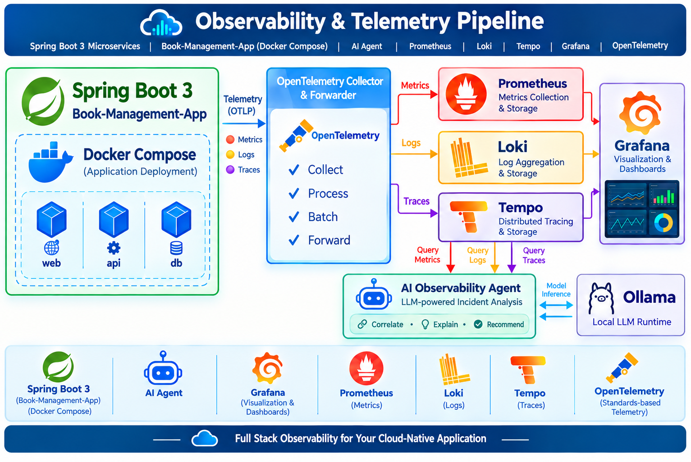
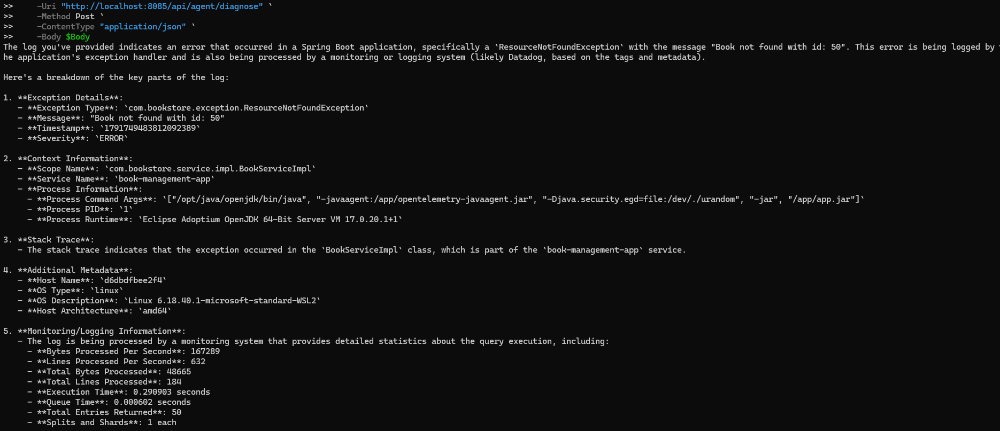
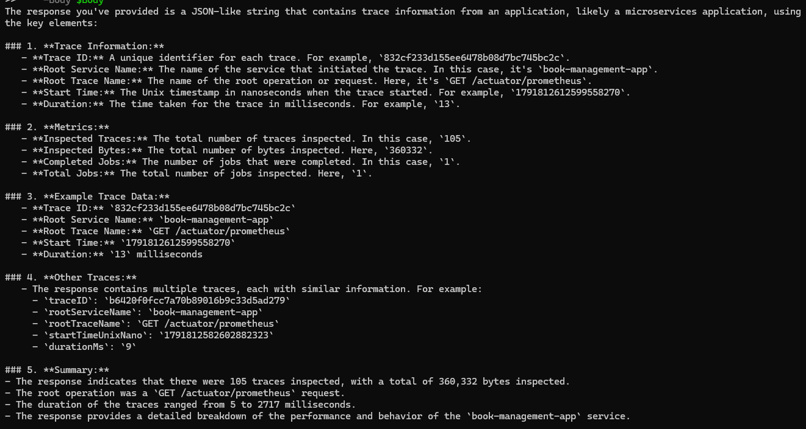
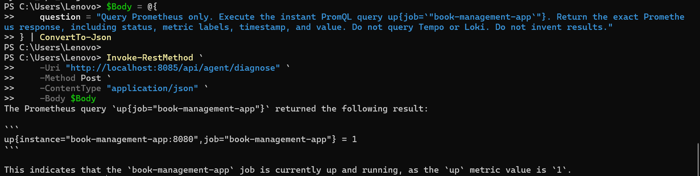
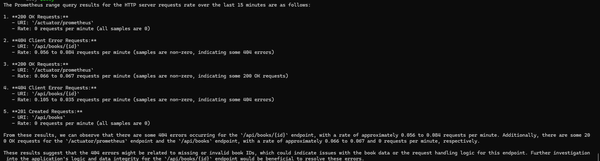

# AI Observability Agent | Spring Boot 3, OpenTelemetry & Grafana Stack

### Overview

This project demonstrates an **end-to-end observability architecture for AI Agent with Ollama LLM Model analyses the application metrics, logs, and distributed traces of  Spring Boot 3 microservice(book-managementa-app)**. It provides a unified approach to analysing logs, traces of Grafana observability ecosystem.

### 🏗️ Architecture Diagram




### Technology Stack

| Component          | Purpose                            | Description                                                                          | Reference Links                                                                                                                                                                      |
|--------------------|------------------------------------|--------------------------------------------------------------------------------------|--------------------------------------------------------------------------------------------------------------------------------------------------------------------------------------|
| **Java 17**        | Spring Boot runtime                | LTS Java version used to run the application                                         | [OpenJDK](https://openjdk.org/) · [Java Downloads](https://www.oracle.com/java/technologies/downloads/)                                                                              |
| **Spring Boot 3**  | Application framework              | Provides REST APIs, Actuator, dependency management, and configuration               | [Spring Boot Documentation](https://docs.spring.io/spring-boot/index.html) · [Spring Boot 3 Reference](https://docs.spring.io/spring-boot/3.4/reference/index.html)                  |
| **Maven**          | Build and package application      | Compiles code, manages dependencies, runs tests, and creates the JAR                 | [Maven Documentation](https://maven.apache.org/guides/) · [Maven Installation](https://maven.apache.org/install.html)                                                                |
| **H2 Database**    | In-memory database                 | Stores book data during application execution                                        | [H2 Database](https://www.h2database.com/html/main.html)                                                                                                                             |
| **Docker**         | Containerization                   | Packages the application into a portable container image                             | [Docker Documentation](https://docs.docker.com/) · [Docker Desktop for Windows](https://docs.docker.com/desktop/setup/install/windows-install/)                                      |
| **Docker Compose** | Container orchestration            | Runs and manages application containers and their dependencies                       | [Docker Compose Documentation](https://docs.docker.com/compose/) · [CLI Reference](https://docs.docker.com/reference/cli/docker/compose/)                                            |
| **OpenTelemetry**  | Telemetry instrumentation          | Provides standard APIs, SDKs, and instrumentation for metrics, logs, and traces      | [OpenTelemetry Documentation](https://opentelemetry.io/docs/) · [Java Instrumentation](https://opentelemetry.io/docs/zero-code/java/agent/)                                          |
| **Prometheus**     | Metrics                            | Collects and stores time-series metrics for monitoring and alerting                  | [Prometheus Documentation](https://prometheus.io/docs/introduction/overview/) · [Configuration Reference](https://prometheus.io/docs/prometheus/latest/configuration/configuration/) |
| **Grafana Loki**   | Log aggregation                    | Stores and queries application logs                                                  | [Loki Documentation](https://grafana.com/docs/loki/latest/) · [LogQL Documentation](https://grafana.com/docs/loki/latest/query/)                                                     |
| **Grafana Tempo**  | Distributed tracing                | Stores distributed traces for request-flow and latency analysis                      | [Tempo Documentation](https://grafana.com/docs/tempo/latest/) · [TraceQL Documentation](https://grafana.com/docs/tempo/latest/traceql/)                                              |
| **Grafana**        | Visualization and dashboards       | Provides a unified view of metrics, logs, and traces                                 | [Grafana Documentation](https://grafana.com/docs/grafana/latest/) · [Data Sources](https://grafana.com/docs/grafana/latest/datasources/)                                             |
| **Ollama**         | Large Language Model (LLM) runtime | Runs and serves local AI models for inference and AI-powered observability diagnosis | [Ollama Documentation](https://docs.ollama.com/) · [Ollama API](https://docs.ollama.com/api) · [Model Library](https://ollama.com/library)                                           |


### Verify the Installation
Run these commands before starting the project:

```powershell
java -version
mvn -version
git --version
docker --version
docker compose version
ollama --version
```

## Directory - to start the deployment

PowerShell:

```cmd
git clone https://github.com/satya-moganti/ai-observability.git
cd ai-observability
```

### Project Structure
```text
ai-observability/
├── architecture.png
├── docker/
├── docs/
├── README.md
├── .gitignore
├── book-management-app/
│   ├── build.gradle
│   ├── settings.gradle
│   ├── Dockerfile
│   ├── README.md
│   ├── .gitignore
│   ├── src
│   └──  pom.xml
├── ai-observability-agent/
│   ├── pom.xml
│   ├── Dockerfile
│   ├── README.md
│   ├── src
├── docker/
│   ├── docker-compose.yml
│   ├── prometheus/prometheus.yml
│   ├── loki/loki-config.yaml
│   ├── tempo/tempo.yaml
│   ├── otel-collector/otel-collector-config.yaml
│   └── grafana/datasources.yaml

```
---
# 🚀 Deployment 

### Docker Compose Deployment (Recommended - Full Observability Stack)

This option runs the entire stack: Application(book-management-app, ai-observability-agent) + OpenTelemetry Collector + Prometheus + Loki + Tempo + Grafana

```cmd
#### Build and start all services
cd docker

#### Build and start/recreate services:
docker compose up --build -d 

#### Check View logs
docker-compose logs -f book-management-app

docker-compose logs -f ai-observability-agent

#### To Stop all services
docker-compose down

##### To Stop and remove volumes
docker-compose down -v
```
### Verify Services 
**Access URLs (Docker):**
- Book Management API | http://localhost:8080
- Actuator health | http://localhost:8080/actuator/health
- Prometheus metrics endpoint | http://localhost:8080/actuator/prometheus
- Prometheus | http://localhost:9090
- Loki readiness | http://localhost:3100/ready
- Tempo query API | http://localhost:3200
- Grafana | http://localhost:3000
- Alloy UI | http://localhost:12345
- AI Agent health | http://localhost:8090/health
- Ollama API | http://localhost:11434
- H2 Console: http://localhost:8080/h2-console

---
### Querying Loki, Tempo, Prometheus Using ai-observability-agent 

#### QUERY LOKI
```powershell
$Body = @{
    question = "Query Loki only. Retrieve the last 15 minutes of logs for book-management-app. Show the actual Loki query, matching log entries, timestamps, and any errors. Do not invent results."
} | ConvertTo-Json

Invoke-RestMethod `
    -Uri "http://localhost:8085/api/agent/diagnose" `
    -Method Post `
    -ContentType "application/json" `
    -Body $Body


```

#### RESPONSE 




#### QUERY TEMPO

```powershell
$Body = @{
    question = "Query Tempo only. Search for traces from book-management-app during the last 15 minutes. Return trace IDs, service names, durations, and any errors available from Tempo. Do not invent results."
} | ConvertTo-Json

Invoke-RestMethod `
    -Uri "http://localhost:8085/api/agent/diagnose" `
    -Method Post `
    -ContentType "application/json" `
    -Body $Body
```

#### RESPONSE



#### QUERY PROMETHEUS

Request 1: 

```poweshell
$Body = @{
    question = "Query Prometheus only. Execute the instant PromQL query up{job=`"book-management-app`"}. Return the exact Prometheus response, including status, metric labels, timestamp, and value. Do not query Tempo or Loki. Do not invent results."
} | ConvertTo-Json

Invoke-RestMethod `
    -Uri "http://localhost:8085/api/agent/diagnose" `
    -Method Post `
    -ContentType "application/json" `
    -Body $Body
```
#### RESPONSE



Request 2:
```poweshell
$Body = @{
    question = @"
Query Prometheus only.

Call the Prometheus RANGE query tool with these exact arguments:
- query: rate(http_server_requests_seconds_count{job="book-management-app"}[5m])
- minutesBack: 15
- step: 1m

Return the actual timestamped samples returned by the tool.
Do not substitute an instant query.
Do not query JVM metrics, Tempo, or Loki.
If the range tool is unavailable or fails, report that explicitly.
Do not invent results.
"@
} | ConvertTo-Json -Depth 5

Invoke-RestMethod `
    -Uri "http://localhost:8085/api/agent/diagnose" `
    -Method Post `
    -ContentType "application/json" `
    -Body $Body
```

#### RESPONSE


### Important Notes

- **Java and Spring Boot:** Spring Boot 3 requires Java 17 or later. Use the Spring Boot version configured in your project's `pom.xml`.
- **H2 Database:** An in-memory database normally loses its data when its database instance is recreated.
- **OpenTelemetry:** Instrumentation and exporters must be configured to send telemetry to the appropriate backends. An OpenTelemetry Collector is required only if your architecture uses one.
- **Prometheus, Loki, and Tempo:** Each backend needs appropriate scraping, log ingestion, or trace ingestion configuration.
- **Grafana:** Configure Prometheus, Loki, and Tempo as data sources to explore metrics, logs, and traces.
- **Ollama:** Download a model compatible with the model name configured in the AI Observability Agent. Model performance depends on the model size and available system resources.
- **Docker Compose:** Kubernetes and Helm are not required when all components are deployed using Docker Compose.


If Ollama is not defined in the Compose file, the commands that target the `ollama` service will not work until you configure that service or use a separately installed Ollama instance.

### Network and Configuration Requirements

- Docker Compose services must be able to communicate over the appropriate Docker network.
- Configure the correct Prometheus, Loki, Tempo, and Ollama URLs for the environment in which the agent runs.
- Configure the Ollama model name in the application's settings.
- Ensure required ports are available and published only where needed.
- Configure Spring Boot Actuator and OpenTelemetry instrumentation for the telemetry you intend to collect.
- Ensure the agent has suitable timeouts for external HTTP requests and model inference.

